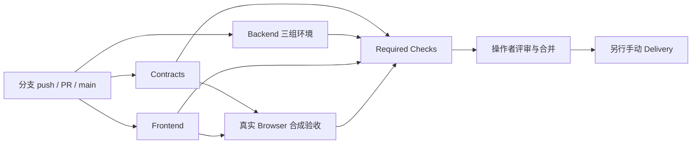

# Magpie 工程流水线使用说明

本说明对应应用 0.30.0 / schema v19，工程流程的修改不改变业务版本。实施方案和实际验证见 [改造方案](ci-delivery-plan.md)及[本地验收记录](ci-delivery-verification.md)。参考 [BobcGn/final 的工程 CI](https://github.com/BobcGn/final/blob/main/.github/workflows/ci.yml)，保留 Magpie 的本地先验收、单一事实源、零隐式出站与旧数据保护要求。

## 1. 日常开发会发生什么

所有分支 push、指向 main 的 PR、merge queue 及手动运行会触发 `Magpie CI`。CI 不打包、不更新 edge、不创建标签或 Release。

首次在 GitHub 实验：推送 `codex/ci-delivery-pipeline` 分支后，到仓库 Actions → Magpie CI 打开这次分支运行。先查看 Contracts，再查看 Backend / Frontend / Browser，最后以 Required Checks 为准。失败时打开对应步骤日志；后端与浏览器的 artifact 会保留日志/截图。这个阶段无需合并 main，也无需配置发布密钥。新建的 Delivery 工作流尚未进入默认分支时，看不到手动入口是正常现象。



| 稳定检查名 | 内容 | 结果位置 |
|---|---|---|
| Contracts | 事实文件、版本/迁移、OpenAPI 快照结构、Actions 语法、11 条红线、交付门禁回归 | Actions 日志 |
| Backend (...) | Linux/Windows Python 3.13，Linux Python 3.11；每组完整 check.py | check.log、coverage.xml artifact |
| Frontend | Node 22.19.0；npm ci、完整前端测试、构建与静态资源逐字节重现 | Actions 日志 |
| Browser | 隔离 dev.py、API 组合条件/分页/样本对照/证据、空项目、1000px 与生产静态页面 | 截图、结果 JSON、环境记录 artifact |
| Required Checks | 汇总上述四类，失败、取消、跳过均不能通过 | 分支保护使用此名称 |

覆盖率合并四组 pytest 的 Python 进程内统计，不能代表浏览器或外部 CLI 子进程的完整覆盖。当前先记录基线，不设未经测量的 80%/90% 阈值。严格计时性能仍在固定本地环境执行，不在共享 runner 上伪造达标结论。

## 2. 本地检查

使用可用且符合项目要求的解释器；首选 Python 3.13。本机历史验收使用的 `.venv-dev` 为 3.12.4，不能据此声称已验 3.13。

```powershell
.venv-dev/Scripts/python.exe -X utf8 scripts/ci/contracts.py
.venv-dev/Scripts/python.exe -X utf8 -m unittest discover -s scripts/ci/tests -v
.venv-dev/Scripts/python.exe -X utf8 check.py
cd frontend
npm test
npm run build
cd ..
.venv-dev/Scripts/python.exe -X utf8 scripts/ci/contracts.py --web-only
```

Contracts 的变更检查以完整 base commit SHA 与 HEAD 比较；CI 会传入事件的真实基线。本地尚未提交的修改另用 `git diff --check` 和 `git diff --cached --check` 检查，按原约定排除第三方生成资源中的既有行尾空白。`--web-only` 同时检查已跟踪和未跟踪的前端构建产物，不能靠忽略新文件让检查变绿。

### 浏览器验收

浏览器测试工具独立于应用依赖。CI 在临时工具目录安装固定 Playwright 1.62.1 和 Chromium；没有向 `frontend/package.json` 或运行时依赖增加测试工具。本地命令不会自动安装或下载。

在已有 Playwright 的 `node_modules` 目录配置 `MAGPIE_PLAYWRIGHT_ROOT`。已有 Chrome 可通过 `MAGPIE_BROWSER_EXECUTABLE` 指定，省去下载测试浏览器。需要可见窗口时：

```powershell
$env:MAGPIE_PLAYWRIGHT_ROOT='<已有 Playwright 的 node_modules 绝对路径>'
$env:MAGPIE_BROWSER_EXECUTABLE='<已有 chrome.exe 的绝对路径>'
$env:MAGPIE_BROWSER_HEADLESS='0'
.venv-dev/Scripts/python.exe -X utf8 scripts/ci/browser.py
```

每次生成新的 `.magpie-dev/ci-browser-<随机标识>/` 合成库；绝不覆盖已有库。端口使用高位随机候选，由 dev.py 实际监听/strictPort 校验；端口占用会明确失败，可重新运行，不会终止已有服务。测试结束只清理本次启动的服务进程，合成库保留。截图、JSON 和脱敏日志位于 `_scratch/ci-browser/<标识>/`；含一次性 token 的开发日志留在 `_scratch/ci-private/`，不会作为 CI 制品上传。

2026-10-24 起同一新工作区还包含独立研究资料合成项目，自动验收笔记/人工字段逐字段冲突核对、任务证据持久化、本地 JS 导入来源与增量 Undo/Redo、正式页面和窄桌面。各场景必须全部通过，不能因 API 筛选通过而跳过研究资料回归；实际验证见[研究优化验收](research-merge-performance-verification.md)。

CI 的 headless 浏览器不能替代操作者要求的本地可见浏览器验收；两者应分别记录。浏览器结果中的 source SHA 和 tracked_changes 如实表示运行时工作区状态，不自动为未提交修改伪造 SHA 证明。

## 3. 手动打包与草稿 Release

`Magpie Delivery` 只有 workflow_dispatch。此文件需先经操作者合入 main，GitHub 才显示 Run workflow；本地创建文件不等于远程启用。

1. 选定 main 上一个成功的 **Magpie CI** 运行，复制运行 ID 和完整 40 位提交 SHA。
2. 按项目约定在本地浏览器验收对应代码，保存真实 Markdown 记录。不能把过去版本的截图冒充新提交的验收。
3. 从 main 手动运行 Delivery，填写 CI run ID、expected_sha、local_evidence 路径，并明确勾选 local_browser_verified。
4. 默认不勾选 create_draft：只生成 Windows ZIP、Linux tar.gz、每个平台的 JSON 清单和 SHA256SUMS，保存 14 天。
5. 确实需要草稿时才勾选 create_draft。草稿任务进入 release 环境，重新校验下载制品后创建一个新标签和草稿；不会发布，不删除/移动 edge，不覆盖现有标签或 Release。

门禁会拒绝失败/未完成 CI、PR/fork/其他仓库运行、非 main、SHA 不一致、缺少本地声明或无法在源提交找到验收文档。人工声明与文件存在检查不等于机器验证了内容真实性；操作者仍须负责核对。

清单绑定版本、完整源 SHA、平台、归档文件名、字节数与 SHA-256。聚合步骤要求恰好两个平台、版本一致、没有额外文件或软链接，发布前再次校验。不是一次绿色构建就随意从另一个分支重新打包。

若标签已存在会失败，不能使用强推或 clobber 覆盖。若新标签已创建但后续草稿创建失败，标签可能保留；先检查失败原因，不自动删除或移动它。已发布内容的修复应使用新版本与重新验收。

## 4. GitHub 服务端启用步骤

以下均为**待操作者在 GitHub 配置的设置**，仓库文件不能自动开启或证明它们已生效。

### main 保护

在 Settings → Rules → Rulesets 创建并启用针对 main 的规则：要求 PR、必需检查 **Required Checks**、解决讨论、禁止强推和删除。第一次 CI 运行后再选择对应检查。个人项目先不要求“其他成员批准”；有第二位可信评审人后再开启至少一次批准与 CODEOWNERS 审核，避免唯一所有者无法合并自己的工作。管理员例外或绕过权限应按真实协作情况审查。

本仓库所有者当前为 `12-test-12`，CODEOWNERS 使用该真实账号，没有照搬参考团队成员。此文件提供评审归属，不能独立强制审批。

### release 环境

在 Settings → Environments 建立 release，限制 main，并在账户/仓库支持时配置所需评审人及审批规则。工作流引用一个环境名称，并不意味着 GitHub 已替你配置审批；环境未配置时不要声称存在人工审批保护。使用最小权限的默认 GITHUB_TOKEN，不添加个人访问令牌或生产密钥。

服务端操作参考 [GitHub Rulesets 文档](https://docs.github.com/en/repositories/configuring-branches-and-merges-in-your-repository/managing-rulesets/creating-rulesets-for-a-repository)和[环境保护文档](https://docs.github.com/en/actions/reference/workflows-and-actions/deployments-and-environments)。本批实现未修改这些远程设置，也未创建 PR、推送、合并或运行 GitHub 上的交付任务。

## 5. 依赖、平台与回退

Actions 使用已核对的官方完整 commit SHA；更新时需复核版本与来源。actionlint 1.7.12、Playwright 1.62.1、pytest-cov 7.0.0 与 PyInstaller 6.16.0 是构建/测试工具，不是应用运行时依赖；下载只发生在明确的 CI 构建步骤。

本地没有的 Python/OS/Docker/打包工具不冒充已测试。首次远程运行仍需检查三组后端环境、Ubuntu 的浏览器依赖、actionlint 和双平台冻结包。检查变红应修复原因，不通过关闭检查或修改历史事实掩盖失败。

若需回退工程配置，通过新分支恢复相应工作流和脚本并评审，不改业务数据库。旧 main 自动重建 edge 的流程已移除；任何恢复自动发布的决定都应先修改方案并单独评审。
